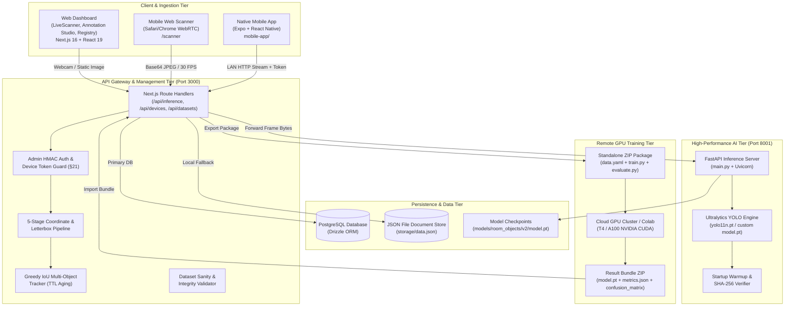
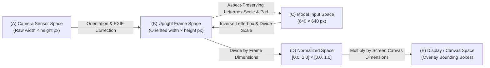
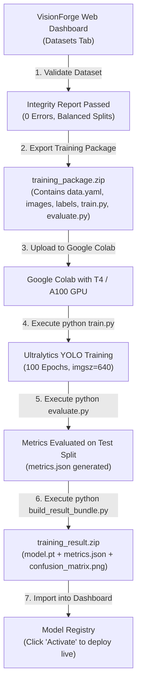

# ⚡ VisionForge AI — Enterprise Edge-to-Cloud YOLOv11 Computer Vision Platform

<div align="center">


**An end-to-end, local-first Computer Vision ecosystem featuring real-time edge & mobile streaming inference, active-learning data annotation, automated remote GPU training orchestration, greedy IoU multi-object tracking, and a production model registry.**

[Key Features](#-key-features) • [System Architecture](#-system-architecture) • [Project Flow](#-end-to-end-project-flow) • [Directory Breakdown](#-complete-codebase-breakdown) • [Quick Start](#-quick-start-guide) • [API Reference](#-api-specification) • [Troubleshooting](#-troubleshooting--faq)

---

</div>

## 🌟 Highlights & Core Capabilities

- **🚀 Real-Time Low-Latency Inference**: 30+ FPS stream processing with sub-25ms inference latency powered by FastAPI, PyTorch, and Ultralytics YOLOv11 with automatic camera letterboxing and resolution adaptation.
- **📱 Universal Mobile Companion Clients**:
  - **Progressive Web Scanner**: Zero-install browser camera client supporting WebRTC/Canvas capture, mobile HTTPS, and back/front camera toggling.
  - **Native Expo React Native App**: Dedicated high-performance Android/iOS camera application with live bounding box rendering overlays and LAN autodiscovery.
- **🔒 Zero-Trust Device Pairing & Single-Streamer Guard**: Cryptographic 6-digit numeric PIN and QR code handshakes with 300s TTLs, session tokens, and strict concurrency controls.
- **🎯 Interactive Web Annotation Studio**: Full-featured browser canvas editor with bounding box drawing, coordinate normalization, undo/redo history stacks, zoom/pan controls, and YOLO center format exports.
- **🔄 Active Learning & Unknown Sample Triage**: Real-time holding pipeline that intercepts low-confidence detections and unknown anomalies, allowing one-click labelling directly into retraining datasets.
- **☁️ Remote GPU MLOps Orchestrator**: Export autonomous, self-contained training bundles (`train.py`, `evaluate.py`, `build_result_bundle.py`, `data.yaml`) for one-click execution on Google Colab or cloud GPUs.
- **🏛️ Model Registry & State Machine Lifecycle**: Formal versioning (`IMPORTED` ➔ `VALIDATING` ➔ `READY` ➔ `ACTIVE` ➔ `DISABLED` ➔ `ARCHIVED` ➔ `FAILED`) with SHA-256 integrity verification, confusion matrices, mAP50 evaluation, and instant one-click rollback.
- **💾 Dual Persistence Architecture**: Production PostgreSQL with Drizzle ORM paired with an automated zero-config JSON Document Store fallback (`storage/data.json`) for seamless local development.

---

## 🏗️ System Architecture

VisionForge operates on a decoupled multi-tier architecture separating high-speed model execution from application state and visualization.



---

## 🔄 End-to-End Project Flow

VisionForge manages the full machine learning lifecycle from initial data acquisition to real-time inference and active continuous retraining.

```mermaid
sequenceDiagram
    autonumber
    actor User as User / Admin
    participant Mobile as Mobile App / Scanner
    participant Gateway as VisionForge Next.js
    participant Inference as FastAPI (YOLO)
    participant Storage as Database / JSON Store
    participant GPU as Google Colab / GPU

    %% Phase 1: Device Pairing
    rect rgb(15, 23, 42)
    Note over User,Mobile: Phase 1: Cryptographic Device Pairing
    User->>Gateway: Open Pairing Modal (QR / 6-Digit PIN)
    Gateway-->>User: Generate 300s TTL Pairing Token
    Mobile->>Gateway: POST /api/devices/pair (Token + Device Name)
    Gateway->>Storage: Verify Token & Store Paired Device
    Gateway-->>Mobile: Issue Session Bearer Token (sess_...)
    end

    %% Phase 2: Live Inference & Tracking
    rect rgb(2, 44, 34)
    Note over Mobile,Inference: Phase 2: High-Speed Streaming Inference
    loop Every 33ms (30 FPS)
        Mobile->>Gateway: POST /api/inference/frame (Base64 JPEG + Token)
        Gateway->>Gateway: Check Concurrency Guard & Byte Limits
        Gateway->>Inference: POST /infer (Binary Stream)
        Inference->>Inference: Predict YOLOv11 (imgsz=416, CPU/CUDA)
        Inference-->>Gateway: Raw Bounding Boxes + Confidence
        Gateway->>Gateway: Greedy IoU Tracking (Assign track_id)
        Gateway-->>Mobile: Upright & Normalized Coordinates [x1, y1, x2, y2]
    end
    end

    %% Phase 3: Active Learning Triage
    rect rgb(30, 27, 75)
    Note over Gateway,Storage: Phase 3: Active Learning & Unknown Triage
    Gateway->>Gateway: Detect Low Confidence (< 0.25) or Unknown
    Gateway->>Storage: POST /api/unknown-samples (Holding Area)
    User->>Gateway: Review Holding Area in Annotation Studio
    User->>Storage: Assign True Label & Add to Dataset Split
    end

    %% Phase 4: Remote Training Loop
    rect rgb(67, 20, 7)
    Note over User,GPU: Phase 4: Autonomous Remote GPU Training
    User->>Gateway: Request Training Package (Dataset vN)
    Gateway-->>User: Download training_package_vN.zip
    User->>GPU: Upload to Colab & Execute python train.py
    GPU->>GPU: Train YOLOv11n (100 Epochs) + evaluate.py
    GPU->>GPU: Package build_result_bundle.py (metrics.json, model.pt)
    GPU-->>User: Download training_result.zip
    User->>Gateway: Import training_result.zip to Model Registry
    Gateway->>Storage: Verify SHA-256 & Register Version (State: READY)
    User->>Gateway: Click 'Activate Version' (State: ACTIVE)
    Gateway->>Inference: Reload Active Checkpoint & Re-warmup
    end
```



---

## 📐 The 5-Stage Coordinate Transformation Pipeline

VisionForge resolves coordinate mismatches across mobile camera sensors, letterboxed neural network inputs, and responsive web canvases using a deterministic 5-stage transformation pipeline (`src/lib/coordinates.ts`):



1. **Camera/Capture Space**: Raw physical sensor pixels with device orientation metadata.
2. **Upright Frame Space**: Orientation-adjusted pixel space conforming to standard landscape/portrait layouts.
3. **Model Input Space**: Fixed square input (e.g. 640×640 or 416×416) with uniform scale and symmetrical letterbox padding to maintain object aspect ratios without distortion.
4. **Normalized Space**: Resolution-independent floating point coordinates bounded between `0.0` and `1.0`.
5. **Display / Canvas Space**: High-DPI browser canvas pixels dynamically rendered on responsive viewports.

---

## 🎯 Target Object Classes

VisionForge includes support for 12 classroom, office, and room object categories, mapped and harmonized across open-source benchmarks:

| ID | Class Name | Color Code | Source | COCO Equivalent | Description |
|:--:|:-----------|:----------:|:------:|:---------------:|:------------|
| `0` | **book** | `#3B82F6` | Pretrained | `book` | Textbooks, reading books, novels |
| `1` | **notebook** | `#10B981` | Custom | `—` | Spiral notebooks, exercise pads, writing books |
| `2` | **chair** | `#F59E0B` | Pretrained | `chair` | Office chairs, classroom desks, stools |
| `3` | **table** | `#EC4899` | Custom | `dining table` | Study desks, dining tables, work surfaces |
| `4` | **air_conditioner** | `#8B5CF6` | Custom | `—` | Split ACs, wall units, AC vents |
| `5` | **laptop** | `#06B6D4` | Pretrained | `laptop` | MacBooks, Windows laptops, personal PCs |
| `6` | **mobile_phone** | `#EF4444` | Pretrained | `cell phone` | Smartphones, iPhones, Android devices |
| `7` | **bottle** | `#14B8A6` | Pretrained | `bottle` | Water bottles, flasks, thermoses |
| `8` | **backpack** | `#F97316` | Custom | `backpack` | College bags, backpacks, laptop bags |
| `9` | **keyboard** | `#6366F1` | Custom | `keyboard` | Mechanical keyboards, laptop keyboards |
| `10`| **mouse** | `#84CC16` | Custom | `mouse` | Optical mice, trackpads |
| `11`| **person** | `#E11D48` | Pretrained | `person` | Students, instructors, operators |

> [!TIP]
> The automated ingestion utility `merge_datasets.py` converts multiple international formats (Portuguese classroom datasets like `cadeira`, `celular`, `pessoa`, `notebook`) and Roboflow formats directly into this 12-class schema.

---

## 📁 Complete Codebase Breakdown

```text
c:\Users\mehun\OneDrive\Desktop\Project\YOLO\
├── 📄 package.json                    # Root Next.js & workspace dependencies (React 19, Drizzle, etc.)
├── 📄 tsconfig.json                    # Strict TypeScript compiler options & module aliasing (@/*)
├── 📄 next.config.ts                   # Next.js production build & experimental configuration
├── 📄 drizzle.config.json              # Drizzle ORM PostgreSQL database migration schema config
├── 📄 .env                             # Active environment configuration (Storage, Ports, Secrets)
├── 📄 merge_datasets.py                # Standalone multi-dataset harmonizer & YOLO data.yaml builder
├── 📄 storage.py                       # Python thread-safe JSON detection storage singleton
├── 📄 flow.md                          # Comprehensive project implementation flow & Colab runbook
├── 📄 DETECTION_TROUBLESHOOTING.md     # Diagnostic runbook for PostgreSQL, camera, and API health
│
├── 📂 src/                             # Next.js Application Source Code
│   ├── 📂 app/                         # Next.js App Router (Pages & API Handlers)
│   │   ├── 📄 layout.tsx               # Root application HTML shell & metadata
│   │   ├── 📄 page.tsx                 # Main VisionForge multi-tab operator dashboard
│   │   ├── 📄 globals.css              # Global styles & Tailwind CSS v4 directives
│   │   │
│   │   ├── 📂 scanner/                 # Web Mobile Scanner Companion
│   │   │   └── 📄 page.tsx             # Responsive camera streaming UI with WebRTC capture
│   │   │
│   │   └── 📂 api/                     # REST API Endpoints
│   │       ├── 📂 auth/login/          # Admin authentication with HMAC session cookies
│   │       ├── 📂 classes/             # Class ontology metadata endpoint
│   │       ├── 📂 datasets/            # Dataset CRUD, import/export, image upload
│   │       │   └── 📂 [id]/            # Individual dataset operations
│   │       │       ├── 📂 classes/     # Class modifications for specific dataset
│   │       │       ├── 📂 export/      # Pure YOLO ZIP dataset export
│   │       │       ├── 📂 images/      # Dataset image storage & base64 ingestion
│   │       │       ├── 📂 split/       # Deterministic sha256-based train/val/test splitting
│   │       │       └── 📂 validate/    # Deep dataset integrity verification endpoint
│   │       ├── 📂 devices/             # Device pairing & active streaming management
│   │       │   ├── 📄 route.ts         # Device listing, token generation & revocation
│   │       │   └── 📂 pair/            # QR/Numeric code handshake & token consumption
│   │       ├── 📂 health/              # Aggregated system & inference health check
│   │       ├── 📂 inference/           # High-speed inference gateways
│   │       │   ├── 📂 frame/           # Real-time streaming frame ingestion (§21 Concurrency Guard)
│   │       │   └── 📂 image/           # Single test image batch inference
│   │       ├── 📂 models/              # Model registry queries & metadata
│   │       │   └── 📂 [id]/versions/   # Model version promotion, activation & rollback
│   │       ├── 📂 system/              # System configuration & structured logs
│   │       │   ├── 📂 config/          # Runtime dynamic tunable settings
│   │       │   └── 📂 logs/            # Structured audit logs query endpoint
│   │       ├── 📂 training/            # Remote GPU training orchestrator
│   │       │   ├── 📂 export-package/  # Autonomous Colab ZIP generator
│   │       │   └── 📂 import-result/   # Checksum-verified result bundle ingestion
│   │       └── 📂 unknown-samples/     # Active learning anomaly triage pipeline
│   │
│   ├── 📂 components/                  # Premium Reactive UI Components
│   │   ├── 📄 Navbar.tsx               # Sticky header with telemetry badges & tab switching
│   │   ├── 📄 LiveScanner.tsx          # Real-time canvas scanner, HUD overlays, unknown alert triage
│   │   ├── 📄 DatasetsManager.tsx      # Dataset browser, class management, split visualizer, validation
│   │   ├── 📄 AnnotationEditor.tsx     # Bounding box studio, undo/redo history, zoom/pan canvas
│   │   ├── 📄 ModelRegistry.tsx        # Version timeline, metric cards, activation/rollback controls
│   │   ├── 📄 TrainingHub.tsx          # Hyperparameter tuner, package exporter, bundle uploader
│   │   ├── 📄 DeviceManager.tsx        # Paired device list, session status, token revocation
│   │   ├── 📄 PairingModal.tsx         # Modal displaying dynamic QR code & 6-digit countdown PIN
│   │   ├── 📄 SystemSettings.tsx       # Live configuration parameter editor & structured audit log
│   │   └── 📄 AdminAuthGate.tsx        # Administrator security barrier for sensitive operations
│   │
│   ├── 📂 db/                          # Database Persistence Layer
│   │   ├── 📄 index.ts                 # PostgreSQL connection pool with Drizzle instance
│   │   ├── 📄 schema.ts                # Complete PostgreSQL relational schema definitions
│   │   └── 📄 seed.ts                  # Database initializer for default classes & system settings
│   │
│   └── 📂 lib/                         # Core Engineering Libraries & Utilities
│       ├── 📄 api-response.ts          # Standardized JSON response envelope wrappers
│       ├── 📄 auth.ts                  # Bearer token validation, device auth, admin authorization
│       ├── 📄 coordinates.ts           # 5-Stage Letterbox & Coordinate transformation math
│       ├── 📄 detector.ts              # Local detector singleton & frame transformation engine
│       ├── 📄 inference-service.ts     # HTTP client communicating with Python FastAPI backend
│       ├── 📄 json-store.ts            # Zero-dependency local JSON document database engine
│       ├── 📄 tracker.ts               # Greedy IoU multi-object tracking with age & TTL decay
│       ├── 📄 validator.ts             # Dataset integrity checker (box limits, aspect ratios, missing)
│       └── 📄 yolo-export.ts           # Zip packaging engine for YOLO datasets & Colab training bundles
│
├── 📂 inference_service/               # Python FastAPI Microservice (Port 8001)
│   ├── 📄 main.py                      # FastAPI app: /infer, /health, /validate, /storage endpoints
│   ├── 📄 test_service.py              # PyTest test suite testing health & normalized bounding boxes
│   ├── 📄 requirements.txt             # Python pinned dependencies (ultralytics, fastapi, uvicorn)
│   ├── 📄 yolo11n.pt                   # Base Ultralytics YOLOv11 nano model checkpoint
│   └── 📄 README.md                    # Service-specific setup & run instructions
│
├── 📂 mobile-app/                      # Native Mobile Companion App (React Native + Expo)
│   ├── 📄 App.tsx                      # CameraView client with live bounding box overlay HUD
│   ├── 📄 package.json                 # Expo 57, React Native 0.86, Expo Camera dependencies
│   ├── 📄 app.json                     # Expo mobile bundle configuration
│   └── 📄 fix-virtual-view.js          # React Native post-install compatibility patch
│
└── 📂 models/                          # Production Model Weights Storage
    └── 📂 room_objects/
        └── 📂 v2/
            └── 📄 model.pt             # Trained YOLO weights checkpoint
```

---

## 🚀 Quick Start Guide

You can launch VisionForge in two modes:
1. **Local Rapid Mode** (Recommended): Uses the zero-config JSON database — **no PostgreSQL required!**
2. **Production Mode**: Uses PostgreSQL for enterprise scalability.

### Prerequisites

- **Node.js**: `v20.x` or `v22.x` installed
- **Python**: `v3.10`, `v3.11`, or `v3.12` installed
- **Git**

---

### Step 1: Clone and Configure Environment

```bash
# Clone the repository
git clone https://github.com/madank21/YOLO.git
cd YOLO

# Configure environment (A working default .env is pre-configured)
# Verify .env contents:
STORAGE_TYPE=json
STORAGE_PATH=storage/data.json
ADMIN_API_KEY=your_generated_secret_key
INFERENCE_SERVICE_URL=http://127.0.0.1:8001
YOLO_MODEL_PATH=models/room_objects/v2/model.pt
YOLO_DEVICE=cpu
```

---

### Step 2: Start the Python FastAPI Inference Service

Open a terminal and set up the Python environment:

```powershell
# Navigate to the inference service directory
cd inference_service

# Create virtual environment
python -m venv .venv

# Activate virtual environment (Windows PowerShell)
.\.venv\Scripts\Activate.ps1
# On Linux/macOS: source .venv/bin/activate

# Install dependencies
pip install -r requirements.txt

# Start the inference microservice on port 8001
python -m uvicorn main:app --host 127.0.0.1 --port 8001 --reload
```

Verify that the inference service is healthy:
```powershell
curl http://127.0.0.1:8001/health
# Expected Output: {"ok": true, "model_version": "room_objects:v2", ...}
```

---

### Step 3: Start the Next.js Web Dashboard

Open a **second terminal** in the project root:

```powershell
# Install Node dependencies
npm install

# Start development server
npm run dev
```

Open your browser and navigate to:
👉 **`http://localhost:3000`**

---

### Step 4: (Optional) Connect Mobile Devices

#### Option A: Mobile Web Scanner (Instant)
1. On your desktop dashboard, click **Pair Phone** in the top navigation bar.
2. Scan the on-screen QR code with your mobile camera, or open:
   ```text
   http://<YOUR_LOCAL_IP>:3000/scanner?code=<NUMERIC_PIN>
   ```
3. Grant camera permissions and begin streaming!

#### Option B: Native Expo Mobile App
1. Navigate to the `mobile-app` directory in a third terminal:
   ```powershell
   cd mobile-app
   npm install
   npx expo start
   ```
2. Press `a` for Android Emulator, or scan the QR code using the **Expo Go** app on your physical smartphone.
3. Enter your desktop LAN address (e.g. `http://192.168.1.50:3000`) and the 6-digit numeric pairing PIN.

---

## ☁️ Remote GPU Training on Google Colab

If you do not have a powerful local NVIDIA GPU, VisionForge allows you to train your models remotely for free using Google Colab.



### Detailed Colab Runbook

1. **Export Package**: Go to **Remote GPU Training** tab in VisionForge Dashboard. Select your dataset, set hyperparameters (`epochs=100`, `batch=16`, `imgsz=640`, `base_checkpoint=yolo11n.pt`), and click **Export Training Package**.
2. **Open Colab**: Navigate to [Google Colab](https://colab.research.google.com/) and create a new notebook.
3. **Select GPU**: Click `Runtime` ➔ `Change runtime type` ➔ Select **T4 GPU** (or A100).
4. **Upload & Extract**:
   ```python
   # Upload your training_package.zip using the file manager on the left
   !unzip training_package_*.zip -d training_package
   %cd training_package
   ```
5. **Install Requirements & Train**:
   ```python
   !pip install -r requirements.txt
   !python train.py --data dataset/data.yaml --model yolo11n.pt --epochs 100 --imgsz 640 --batch 16
   ```
6. **Evaluate & Package Result Bundle**:
   ```python
   # Evaluate held-out test split metrics
   !python evaluate.py --weights runs/train/experiment/weights/best.pt --data dataset/data.yaml

   # Assemble result bundle conforming to specification
   !python build_result_bundle.py
   ```
7. **Deploy**: Download `training_result.zip` from Colab, return to the VisionForge Dashboard ➔ **Model Registry** ➔ Click **Import Bundle** ➔ Click **Activate Version**. The new model is instantly live across all connected web and mobile scanners!

---

## 📡 API Specification

VisionForge exposes clean, type-safe REST APIs for client communication and integration.

### Inference & Health

| Method | Endpoint | Description | Auth Required |
|:-------|:---------|:------------|:-------------:|
| `GET` | `/api/health` | Aggregated system, model checksum, and inference status | None |
| `POST`| `/api/inference/frame` | Real-time streaming frame ingestion (Base64 JPEG) | Device Bearer / Admin |
| `POST`| `/api/inference/image` | Static single image inference with detection metrics | Device Bearer / Admin |

<details>
<summary><b>🔍 Sample Request: Streaming Frame Ingestion (POST /api/inference/frame)</b></summary>

```json
{
  "type": "frame",
  "session_id": "expo_1730419200000",
  "frame_id": 142,
  "timestamp": 1730419200150,
  "format": "jpeg",
  "width": 1280,
  "height": 720,
  "orientation": 1,
  "data": "data:image/jpeg;base64,/9j/4AAQSkZJRgABAQ...",
  "confidence_threshold": 0.25
}
```

**Response (200 OK):**
```json
{
  "success": true,
  "type": "detections",
  "sessionId": "expo_1730419200000",
  "frameId": 142,
  "model_version": "room_objects:v2",
  "device": "cpu",
  "inference_ms": 21.4,
  "objects": [
    {
      "class_id": 5,
      "class_name": "laptop",
      "confidence": 0.92,
      "track_id": 3,
      "x1": 340, "y1": 180, "x2": 720, "y2": 490,
      "x1_norm": 0.2656, "y1_norm": 0.2500, "x2_norm": 0.5625, "y2_norm": 0.6806,
      "is_unknown": false
    }
  ]
}
```
</details>

---

### Device Pairing & Management

| Method | Endpoint | Description | Auth Required |
|:-------|:---------|:------------|:-------------:|
| `GET` | `/api/devices` | List all paired devices and active pairing token/QR code | None |
| `POST`| `/api/devices/pair` | Validate 6-digit numeric PIN and issue session token | None |
| `DELETE`| `/api/devices/[id]` | Revoke device access immediately | Admin |

---

### Datasets & Annotations

| Method | Endpoint | Description | Auth Required |
|:-------|:---------|:------------|:-------------:|
| `GET` | `/api/datasets` | List all datasets with image and class statistics | None |
| `POST`| `/api/datasets` | Create a new dataset with optional default classes | None |
| `GET` | `/api/datasets/[id]` | Retrieve dataset details, images, and annotations | None |
| `POST`| `/api/datasets/[id]/split` | Calculate deterministic train/val/test split ratios | None |
| `POST`| `/api/datasets/[id]/validate` | Run comprehensive dataset integrity validator | None |
| `GET` | `/api/datasets/[id]/export` | Download standard YOLO ZIP dataset archive | None |

---

### Model Registry & Remote Training

| Method | Endpoint | Description | Auth Required |
|:-------|:---------|:------------|:-------------:|
| `GET` | `/api/models` | List all registered models and version histories | None |
| `POST`| `/api/models/[id]/versions/[v]/activate` | Promote model version to active runtime | Admin |
| `POST`| `/api/models/[id]/versions/[v]/rollback` | Revert to previous stable model version | Admin |
| `GET` | `/api/training/export-package/[id]` | Download autonomous Colab training package ZIP | None |
| `POST`| `/api/training/import-result` | Upload and verify training result bundle | Admin |

---

## 🛠️ Testing & Verification

VisionForge includes test suites spanning Python model evaluation and TypeScript integrity:

```powershell
# 1. Test Python Inference Microservice
cd inference_service
.\.venv\Scripts\Activate.ps1
pytest -v -q test_service.py

# 2. Run TypeScript Static Analysis
npm run typecheck

# 3. Run ESLint Code Quality Checks
npm run lint
```

---

## ❓ Troubleshooting & FAQ

### 1. "Inference service unavailable" error on Dashboard
- **Root Cause**: The Python FastAPI service is not running on port 8001.
- **Solution**: Open a separate terminal, navigate to `inference_service`, activate `.venv`, and run:
  ```powershell
  python -m uvicorn main:app --host 127.0.0.1 --port 8001
  ```

### 2. Camera permission blocked on Mobile Web Scanner
- **Root Cause**: Modern mobile browsers (iOS Safari, Android Chrome) strictly block camera access over insecure HTTP connections unless running on `localhost`.
- **Solution**:
  - Run Next.js with HTTPS:
    ```powershell
    npm run dev:https
    ```
  - Or use the native **Expo Mobile App** (`mobile-app/`), which connects directly via native mobile camera permissions without browser HTTPS restrictions.

### 3. Model weights file missing (`models/room_objects/v2/model.pt`)
- **Root Cause**: The project requires an initial model checkpoint to boot.
- **Solution**: The base checkpoint `yolo11n.pt` is provided in `inference_service/yolo11n.pt`. You can copy or rename it to `models/room_objects/v2/model.pt` as an initial placeholder prior to custom fine-tuning.

### 4. Bounding boxes appear displaced or distorted
- **Root Cause**: Non-square camera feeds without letterboxing.
- **Solution**: VisionForge implements automatic aspect-ratio letterboxing (`calculateLetterbox` in `src/lib/coordinates.ts`). Ensure your client uses normalized coordinates `[0, 1]` rather than raw pixel coordinates.

---

## 🛡️ Security & Privacy

- **Local-First Execution**: Video streams and camera frames remain entirely within your private local network (LAN). No footage is sent to external third-party servers.
- **Cryptographic Authentication**: Timing-safe equal string comparisons (`crypto.timingSafeEqual`) prevent side-channel timing attacks on API keys and HMAC tokens.
- **Ephemeral Pairing Tokens**: Pairing PINs automatically expire after 300 seconds and are single-use.

---

## 📜 License

This project is licensed under the MIT License — see the [LICENSE](mobile-app/LICENSE) file for details.
